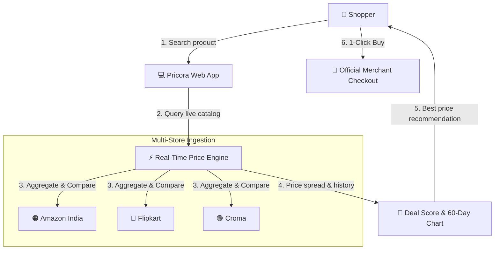

<div align="center">

  # ⚡ PRICORA
  ### *Real-Time E-Commerce Price Comparison Engine for India*

  <p align="center">
    <strong>Stop opening 10 browser tabs. Search once. Compare authentic live prices across Amazon India, Flipkart & Croma in real time.</strong>
  </p>

  <p align="center">
    <a href="https://nextjs.org"></a>
    <a href="https://react.dev"></a>
    <a href="https://www.typescriptlang.org"></a>
    <a href="https://tailwindcss.com"></a>
    <a href="https://recharts.org"></a>
    <a href="https://supabase.com"></a>
    <a href="#license"></a>
  </p>

  <p align="center">
    <a href="#-what-is-pricora">What is Pricora?</a> •
    <a href="#-key-features">Key Features</a> •
    <a href="#-how-it-works">How It Works</a> •
    <a href="#-supported-stores">Supported Stores</a> •
    <a href="#-quick-start">Quick Start</a> •
    <a href="#-tech-stack">Tech Stack</a>
  </p>

</div>

---

## 💡 What is Pricora?

Online shoppers in India waste time jumping between multiple apps and tabs to find the best deal during festive sales and flash drops. **Pricora** is an intelligent price comparison platform that tracks, compares, and visualizes authentic product prices from top Indian retailers in real time.

### Why Shoppers Love Pricora:

| The Problem | How Pricora Solves It |
| :--- | :--- |
| **Tab Fatigue** | Compare Amazon, Flipkart, and Croma side-by-side in one single view |
| **Fake Festive Discounts** | 60-day interactive price history graphs reveal authentic historical lows |
| **Uncertainty ("Should I buy now?")** | Algorithmic Deal Score (0–100) tells you whether to buy or wait |
| **Missed Midnight Drops** | Instant price drop email notifications when prices hit your budget |
| **Cluttered Interfaces** | Vibrant, luminous cyberpunk design with ambient aurora lighting |

---

## ⚡ Key Features

- 🔍 **Instant Keystroke Autocomplete**: Search with real-time live suggestions, product thumbnails, and lowest price tags as you type.
- 🛍️ **Side-by-Side Store Comparison**: Live price checks across Amazon India, Flipkart, and Croma with direct verified purchase links.
- 📉 **60-Day Historical Price Charts**: Interactive time-series visualizer showing genuine price trends and true discount authenticity.
- 🧠 **Algorithmic Deal Score (0–100)**: Instant verdict rating (*"Unreal Steal 🔥"*, *"Great Deal ✨"*, *"Fair Price"*) based on market price spread.
- 🔔 **Targeted Price Drop Alerts**: Subscribe with your email and desired price threshold to receive automated drop alerts.
- 🪔 **Festive Cyberpunk UI**: Sleek dark aesthetic illuminated by dynamic ambient aurora glows, 3D perspective hero cards, and glowing jewel-tone category filters.
- 📊 **Real-Time Admin Telemetry**: Built-in monitoring console displaying live scraper status, tracked listings count, and outbound conversion metrics.

---

## 🏗️ How It Works



---

## 🏪 Supported Stores

<div align="center">

| Store | Status | Capabilities |
| :---: | :---: | :--- |
| **Amazon India** | 🟢 Active | Real-time pricing, Prime delivery status, stock verification |
| **Flipkart** | 🟢 Active | Live Big Billion Days deals, discounts, verified merchant pricing |
| **Croma** | 🟢 Active | Official electronics distributor pricing & brand warranty checks |

</div>

---

## 🚀 Quick Start

Get a local instance running in under a minute:

```bash
# 1. Clone the repository
git clone https://github.com/P01Sensai/Pricora.git
cd Pricora

# 2. Install dependencies
npm install

# 3. Start development server
npm run dev
```

Open **`http://localhost:3000`** in your browser.

---

## 🛠️ Tech Stack

- **Frontend & App Engine**: [Next.js 16 (App Router)](https://nextjs.org) with [React 19](https://react.dev) & [TypeScript](https://www.typescriptlang.org)
- **Styling & Aesthetics**: [Tailwind CSS v4](https://tailwindcss.com) with custom ambient aurora lighting tokens
- **Data Visualization**: [Recharts](https://recharts.org) for 60-day interactive SVG price history graphs
- **Real-Time Ingestion**: Cheerio & Node.js multi-store connectors
- **Database & Telemetry**: [PostgreSQL / Supabase](https://supabase.com) relational catalog storage

---

## 🗺️ Completed Milestones

- [x] Luminous festive aurora design system with 3D perspective carousel
- [x] Real-time multi-store connectors (Amazon India, Flipkart, Croma)
- [x] Instant debounced keystroke search suggestions & category filters
- [x] 60-Day interactive historical price chart component
- [x] Algorithmic deal score & verdict rating engine
- [x] Instant price drop alert subscription workflow
- [x] Outbound affiliate redirector & telemetry conversion logger
- [x] Live admin health monitoring dashboard (`/admin`)

---

## 📄 License

Distributed under the [MIT License](LICENSE).

<div align="center">
  <sub>Built with ❤️ for Indian smart shoppers.</sub>
</div>
