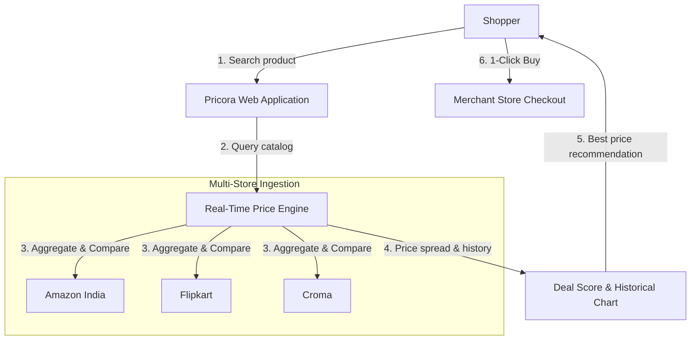

<div align="center">

  # Pricora
  ### Real-Time E-Commerce Price Comparison Engine for India

  <p align="center">
    <strong>Stop opening multiple browser tabs. Search once. Compare authentic live prices across Amazon India, Flipkart, and Croma in real time.</strong>
  </p>

  <p align="center">
    <a href="https://nextjs.org"></a>
    <a href="https://www.typescriptlang.org"></a>
    <a href="https://tailwindcss.com"></a>
    <a href="#license"></a>
  </p>

  <p align="center">
    <a href="#what-is-pricora">What is Pricora?</a> •
    <a href="#key-features">Key Features</a> •
    <a href="#how-it-works">How It Works</a> •
    <a href="#supported-stores">Supported Stores</a> •
    <a href="#quick-start">Quick Start</a> •
    <a href="#tech-stack">Tech Stack</a>
  </p>

</div>

---

## What is Pricora?

Online shoppers in India often spend unnecessary time switching between multiple apps and browser tabs during sales to find the best deal. **Pricora** aggregates, tracks, and verifies product prices from major Indian retailers in real time, giving consumers authentic historical trends and algorithmic buying advice.

### Overview

| The Problem | How Pricora Solves It |
| :--- | :--- |
| **Tab Fatigue** | Compare Amazon, Flipkart, and Croma side-by-side in a single unified view |
| **Fake Sales & Inflated MRPs** | 60-day interactive price history graphs reveal authentic historical lows |
| **Buying Uncertainty** | Algorithmic Deal Score (0–100) indicates whether to buy now or wait |
| **Missed Flash Drops** | Automated price drop email notifications when prices hit your threshold |
| **Cluttered Interfaces** | Clean, fast, and responsive interface illuminated with ambient aurora styling |

---

## Key Features

- **Instant Keystroke Autocomplete**: Search with real-time live suggestions, product thumbnails, and lowest price tags as you type.
- **Side-by-Side Store Comparison**: Live price checks across Amazon India, Flipkart, and Croma with direct verified purchase links.
- **60-Day Historical Price Charts**: Interactive vector charts showing genuine price trends to verify discount authenticity.
- **Algorithmic Deal Score (0–100)**: Instant rating (e.g., *Unreal Steal*, *Great Deal*, *Fair Price*) based on real-time market price spread.
- **Targeted Price Drop Alerts**: Subscribe with an email address and desired budget threshold to receive automated drop alerts.
- **Ambient Design System**: Dark mode interface enhanced with subtle ambient lighting, 3D perspective hero elements, and category filters.
- **Real-Time Admin Telemetry**: Built-in monitoring console displaying live scraper status, tracked listings count, and outbound conversion metrics.

---

## How It Works



---

## Supported Stores

<div align="center">

| Store | Status | Capabilities |
| :--- | :---: | :--- |
| **Amazon India** | Active | Real-time pricing, Prime delivery status, stock verification |
| **Flipkart** | Active | Live sale deals, verified merchant pricing, discount calculation |
| **Croma** | Active | Official electronics distributor pricing and warranty verification |

</div>

---

## Quick Start

Get a local instance running in three simple steps:

```bash
# 1. Clone the repository
git clone https://github.com/P01Sensai/Pricora.git
cd Pricora

# 2. Install dependencies
npm install

# 3. Start development server
npm run dev
```

Open **`http://localhost:3000`** in your browser.

---

## Tech Stack

- **Frontend & App Engine**: [Next.js 16 (App Router)](https://nextjs.org) with [React 19](https://react.dev) and [TypeScript](https://www.typescriptlang.org)
- **Styling**: [Tailwind CSS v4](https://tailwindcss.com) with custom ambient design tokens
- **Data Visualization**: [Recharts](https://recharts.org) for 60-day interactive SVG price history graphs
- **Ingestion**: Cheerio and Node.js multi-store connectors
- **Database & Telemetry**: [PostgreSQL / Supabase](https://supabase.com) relational catalog storage

---

## Completed Milestones

- [x] Ambient aurora design system with 3D perspective carousel
- [x] Real-time multi-store connectors (Amazon India, Flipkart, Croma)
- [x] Instant debounced keystroke search suggestions and category filters
- [x] 60-Day interactive historical price chart component
- [x] Algorithmic deal score and verdict rating engine
- [x] Price drop alert subscription workflow
- [x] Outbound affiliate redirector and telemetry conversion logger
- [x] Live admin health monitoring dashboard (`/admin`)

---

## License

Distributed under the [MIT License](LICENSE).

<div align="center">
  <sub>Built for smart shoppers across India.</sub>
</div>
